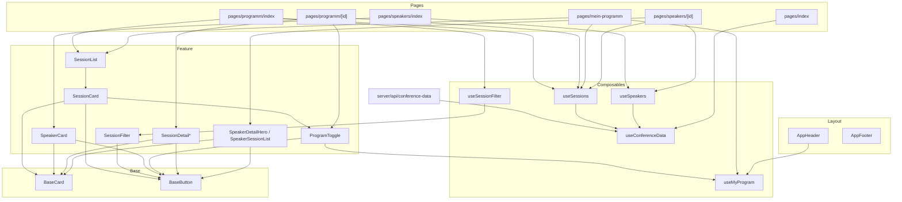

# B — ADR: Komponenten- & Ordnerstruktur

> Federführung: Person 2 · Datum: 2026-10-06 · Aktualisiert: 2026-10-31 auf den Stand nach Schritt 2 (Ordnernamen, Routen, Komponentenübersicht)

## Kontext

FrontRow braucht drei Seitentypen (Übersichten mit Filter, Detailseiten, personalisiertes Dashboard), einen geteilten schreibgeschützten Datensatz und einen kleinen persönlichen State. Die Struktur muss über vier Sprints (Rendering-Strategien, PWA, AI-Protokoll) tragen und für zwei Personen mit parallelem Arbeiten übersichtlich bleiben. Setup ist Nuxt 4 (siehe [ADR D](./04-technologie-adr.md)), dessen Konventionen (`pages/`, `layouts/`, `composables/`, Auto-Imports) die Struktur teilweise vorgeben.

## Optionen

### Ordnerstruktur

**Option 1 — Technische Schichten**
`components/base`, `components/<domäne>` (Feature-Layer: `session`, `speaker`, `program`), `components/layout`, dazu `composables/`, `pages/`, `layouts/`, `types/`.
+ Entspricht der geforderten Schichtung Base/UI → Feature → Layout; passt zu Nuxt-Konventionen; Base-Komponenten sind sofort als domänenfrei erkennbar.
− Bei starkem Wachstum liegen Composable und Komponente eines Features in verschiedenen Ordnern.

**Option 2 — Feature-Slices**
`features/sessions/{components,composables,pages}`, `features/speakers/…`, `shared/ui`.
+ Alles zu einem Feature an einem Ort; skaliert bei vielen Teams.
− Kollidiert mit Nuxt-Auto-Import-Konventionen (`pages/`, `composables/` müssen konfiguriert werden); für 3 Domänen und 2 Personen Overhead ohne Nutzen.

**Option 3 — Flache Struktur (ursprünglicher Teamvorschlag: `components/{layouts,basics,views}`, `router/`)**
+ Wenige Ordner, aus Hausübung 2 vertraut, kein Nuxt-Wissen nötig.
− `router/` und `views/` sind Vue-Router-Konzepte, die in Nuxt durch `pages/` ersetzt werden; `components/layouts` kollidiert mit Nuxts `layouts/`; eine Feature-Schicht fehlt → verworfen, weil das Grundgerüst der Dokumentation widersprechen würde.

### Headless-Aufteilung für die zentrale Interaktion „Session-Filterung"

Die Aufteilung wurde in Schritt 1 vorab entschieden und in Schritt 2 so umgesetzt.

**Option A — Logik als Composable `useSessionFilter()`, Darstellung in `SessionFilter.vue`**
+ Filterzustand und Ableitung sind reine Daten (kein DOM) → ohne Mounting testbar.
+ Dieselbe Logik dient der Programmübersicht und „Mein Programm" (z. B. nach Tag filtern).
+ Die Darstellung ist austauschbar: Selects am Desktop, Chips/Bottom-Sheet am Handy — ohne die Logik anzufassen. URL-Synchronisation (Query-Params) lässt sich später im Composable ergänzen, ohne UI-Änderung.

**Option B — Filterlogik direkt in der Seitenkomponente**
+ Weniger Dateien.
− Logik und Markup verwachsen; jede zweite Verwendung kopiert Code; Tests brauchen DOM.

**Gegenprobe (bewusst nicht headless): „Zum Programm hinzufügen"**
Die Logik ist ein `toggle(id)` auf dem geteilten `useMyProgram()`-State. `ProgramToggle.vue` wird es direkt aufrufen. Ein eigenes Headless-Composable hätte hier keinen Nutzen — es gäbe nichts zu abstrahieren. Headless wird dort eingesetzt, wo echte Wiederverwendung oder Austauschbarkeit entsteht, nicht als Selbstzweck.

## Entscheidung

Option 1 (technische Schichten) + Option A (Filter headless).

Stand nach Schritt 2:

```
app/
├── assets/css/main.css        Tailwind-Einstieg
├── components/
│   ├── base/                  Base/UI-Layer, domänenfrei: BaseCard, BaseButton (mit `to` ein NuxtLink)
│   ├── session/               Feature: SessionCard, SessionList, SessionFilter, SessionDetailHero, SessionDetailGrid, SessionDetailSpeakerCard
│   ├── speaker/               Feature: SpeakerCard, SpeakerDetailHero, SpeakerSessionList
│   ├── program/               Feature: ProgramToggle
│   └── layout/                AppHeader (Navigation + Zähler), AppFooter
├── composables/               useConferenceData (Datenschicht) · useSessions, useSpeakers, useSessionFilter, useMyProgram (Domäne)
├── layouts/default.vue
├── pages/                     index · programm/, programm/[id] · speakers/, speakers/[id] · mein-programm
├── utils/formatDay.ts         einzige Datumsformatierung (Konferenz-Zeitzone)
└── types/conference.ts
server/api/conference-data.get.ts   liest den Datensatz pro Request (siehe Rendering-ADR Schritt 2)
public/data/conference-data.json
docs/schritt1/ · docs/schritt2/
```

Zwei Abweichungen vom ursprünglichen Plan, beide in Schritt 2 entschieden:
- Die Feature-Ordner liegen direkt unter `components/` statt unter `components/features/`. Mit `pathPrefix: false` trägt die Zwischenebene nichts zum Komponentennamen bei, und `session/`, `speaker/`, `program/` sind neben `base/` und `layout/` ebenso klar als Feature-Layer erkennbar. Die Schicht-Regeln gelten unverändert.
- Die Session-Übersicht heißt `/programm` statt `/sessions`, die Detailseite entsprechend `/programm/[id]` (Begriff der Besucher:innen; siehe Rendering-ADR, Nachtrag). `SessionFilterBar` heißt `SessionFilter`.

**Schicht-Regeln:**
- **Base** kennt keine Domäne, keinen State, nur Props/Slots/Emits.
- **Feature** kennt die Domäne, erhält aufgelöste Daten per Props (SessionCard bekommt Track/Room/Speaker fertig) oder nutzt Composables (ProgramToggle), komponiert Base-Komponenten.
- **Layout** rahmt Seiten (Header/Footer), kennt Navigation und den globalen Zähler aus `useMyProgram`.
- **Pages** orchestrieren: `await useSessions()` / `useSpeakers()`, Filter-Composable, Übergabe an Features. Kein Markup-Detail.
- **Composables** sind zweischichtig: `useConferenceData` (Datenschicht: laden, indizieren, joinen) und darauf aufbauende Domänen-Composables (`useSessions`, `useSpeakers`, `useSessionFilter`, `useMyProgram`). Nur die Datenschicht ruft `useAsyncData` auf. Details in [Konzept C](./03-state-management-konzept.md).
- Komponenten werden **ohne Pfad-Präfix** registriert (`pathPrefix: false`) → Dateinamen müssen projektweit eindeutig sein.

## Komponentenübersicht

Stand nach Schritt 2; alle Knoten existieren.



## Konsequenzen

- (+) Jeder neue Teil hat einen eindeutigen Platz; die Schicht-Regeln beantworten im Review die Frage „wo gehört das hin".
- (+) Base-Komponenten sind Kandidaten für eine spätere Komponentenbibliothek; Feature-Komponenten bleiben dünn.
- (+) Filterlogik ist ohne Browser testbar (Vitest, später).
- (−) Eindeutige Dateinamen sind Pflicht (Konvention: Präfix `Base*`, `App*`, Domäne im Namen).
- (−) Wächst das Projekt auf viele Domänen, wäre ein Umzug auf Feature-Slices (Option 2) ein mechanischer Refactor: die Schichtregeln bleiben gleich.
