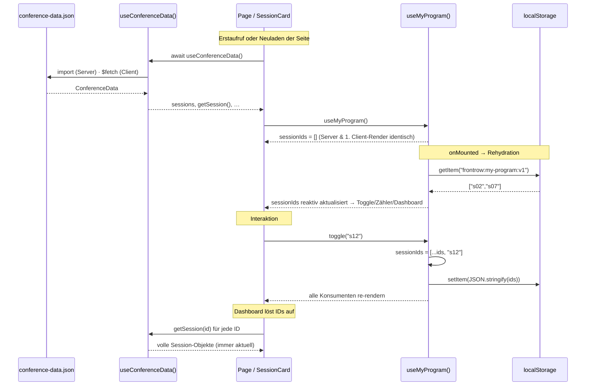

# C — State-Management-Konzept: „Mein Programm" & conference-data.json

> Federführung: Person 2
> Umsetzungsstand: `useConferenceData()` ist in Schritt 1 implementiert; `useMyProgram()` folgt mit den Seiten in Schritt 2.
> Nachtrag Schritt 2: Der Datensatz wird nicht mehr beim Build importiert, sondern serverseitig bei jedem Request gelesen (`/api/conference-data`). Begründung und Konsequenzen im [Nachtrag der Rendering-ADR](../schritt2/01-rendering-strategie-adr.md#nachtrag-zur-umsetzung); die Aussage „ändert sich nur per Deployment“ ist damit präzisiert.

## Zwei Arten von State

| | Geteilter Datensatz | „Mein Programm" |
|---|---|---|
| Quelle | `conference-data.json` (schreibgeschützt) | Nutzer:in |
| Lebensdauer | für alle gleich, ändert sich nur per Deployment | pro Gerät, dauerhaft |
| Größe | 20 Sessions, 18 Speaker | einige IDs |
| Rendering | server-/statisch renderbar | nur im Browser bekannt |

Beide werden getrennt in eigenen Composables modelliert, ohne zusätzliche Library.

## Geteilter Datensatz: `useConferenceData()`

**Laden.** Ein `useAsyncData('conference-data', …)` mit festem Key: Nuxt dedupliziert parallele Aufrufe, überträgt das Ergebnis im Payload zum Client (kein zweiter Fetch) und cached es bei Client-Navigation. Serverseitig wird die Datei importiert, clientseitig aus `/public/data/` geladen — der Pfad, den in Schritt 3 der Service Worker cachen kann. In `localStorage` wird der Datensatz bewusst nicht kopiert: Er ist für alle gleich, eine lokale Kopie veraltet, und Offline-Verfügbarkeit löst der Service Worker auf HTTP-Ebene.

**Modellieren.** Vier Listen als `computed`, `Map`-Indizes für O(1)-Lookups (`getSession(id)` …) und die Joins `speakersForSession()` / `sessionsForSpeaker()`. Komponenten erhalten aufgelöste Objekte per Props.

**Schichtung.** Nur diese Datenschicht ruft `useAsyncData` auf. Domänen-Composables (`useSessionFilter()`, `useMyProgram()`, ab Schritt 2 `useSessions()`) bauen darauf auf, statt selbst zu laden — sonst würde der Datensatz mehrfach geladen und die Joins zerrissen. Schicht-Regeln siehe [ADR B](./02-architektur-adr.md).

## Persönlicher State: `useMyProgram()`

**Datenstruktur: nur IDs** (`string[]`), keine Session-Objekte. Ändert sich im Datensatz ein Raum oder eine Uhrzeit, zeigt „Mein Programm" automatisch den aktuellen Stand statt einer veralteten Kopie; kein Migrationsproblem bei Schema-Änderungen, winziger Storage-Footprint. Der Preis: Der Datensatz muss geladen sein — er ist auf jeder Seite geladen und wird in Schritt 3 offline gecached. Gelöschte IDs werden beim Auflösen still gefiltert.

**Reaktive Verteilung: `useState`.** Pro Key app-weit geteilt und SSR-sicher; Header-Zähler, Toggle und Dashboard lesen dieselbe Referenz. Pinia wäre für ein Array mit vier Mutationen eine Abhängigkeit ohne Mehrwert; ein Modul-`ref` wäre unter SSR ein Shared-State-Leck zwischen Requests.

**Persistenz.** Key `frontrow:my-program:v1` (Versionssuffix für Migrationen). Geschrieben wird explizit in den Mutationen, nicht über einen Watcher am Scope einer Komponente. Fehler (Quota, Private Mode) schlagen still fehl.

**Rehydration.** Einmalig in `onMounted` (Flag `isHydrated`), damit Server-HTML und erster Client-Render identisch sind. Bis dahin zeigt das Dashboard einen Ladehinweis.

## Datenfluss

## Konsequenzen

- (+) Eine Datenquelle, keine Kopien; Programmänderungen schlagen überall durch.
- (+) Kein Store-Framework, zwei kleine typisierte Composables.
- (−) Kurzes Aufblitzen des leeren Zustands vor der Rehydration (Schritt 2: `<ClientOnly>` fürs Dashboard).
- (−) Keine Tab-Synchronisation (per `storage`-Event ergänzbar).
